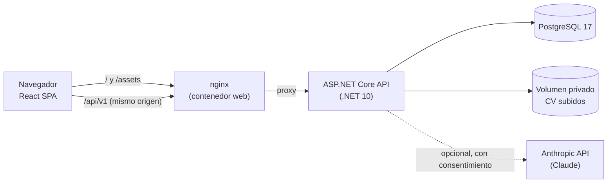
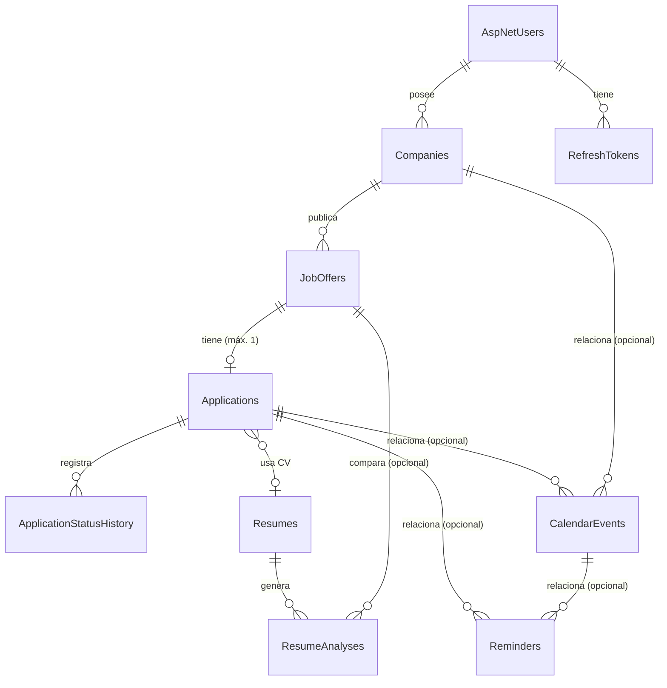

# Arquitectura de JobTrack AI

Este documento recoge las decisiones técnicas importantes, el modelo de datos y las reglas de negocio. Las
instrucciones de instalación están en el [README](../README.md).

## Visión general

El navegador habla con un único origen: nginx sirve la SPA y reenvía `/api` a la API. En desarrollo, el proxy de Vite
cumple el mismo papel. Así la cookie de sesión puede ser `SameSite=Strict` y no hace falta CORS.

## Backend: capas

| Proyecto | Responsabilidad | Depende de |
|---|---|---|
| `JobTrack.Domain` | Entidades, enums, reglas de negocio (máquina de estados de postulaciones, validación de salarios, rangos de eventos). Sin dependencias externas. | — |
| `JobTrack.Application` | Casos de uso (servicios), DTOs, validadores FluentValidation, abstracciones (`IAppDbContext`, `ICurrentUser`, `IUserClock`, `IResumeAnalysisService`, `IFileStorage`, `IResumeTextExtractor`), analizador local de CV y saneamiento de resultados. | Domain, EF Core (abstracciones de consulta) |
| `JobTrack.Infrastructure` | `AppDbContext` + configuraciones EF, migraciones, Identity, JWT/refresh tokens, almacenamiento en disco, extracción PDF/DOCX, proveedor Claude, seed de demostración. | Application |
| `JobTrack.Api` | Controladores REST, autenticación, autorización por defecto, manejo global de errores, rate limiting, Swagger, cabeceras de seguridad. | Infrastructure |
| `JobTrack.Tests` | Pruebas unitarias y de integración (PostgreSQL real, `WebApplicationFactory`). | Api |

## Decisiones (ADR resumidos)

### ADR-01 · Clean Architecture pragmática, sin repositorios ni MediatR
`DbSet<T>` ya es un repositorio y `DbContext` una unidad de trabajo. La capa de aplicación consulta a través de
`IAppDbContext` y proyecta directamente a DTOs con LINQ, lo que da SQL eficiente sin capas de paso. No se usan
MediatR, CQRS ni microservicios: el dominio es pequeño y un servicio por agregado es más legible.
*Coste asumido:* Application depende de las abstracciones de consulta de EF Core.

### ADR-02 · Propiedad de los datos con filtros globales (deny by default)
Cada entidad propia lleva `UserId`. `AppDbContext` aplica `HasQueryFilter(e => e.UserId == CurrentUserId)` a todas
ellas (el historial se filtra a través de su postulación). El id procede **solo** del claim `sub` del JWT validado;
ningún DTO acepta `UserId`. Una petición anónima tiene `Guid.Empty` y no ve nada. Los recursos de otro usuario
responden **404** (no 403) para no revelar su existencia. Al crear relaciones (oferta→empresa, evento→postulación,
postulación→CV…) se comprueba la existencia **a través del filtro**, de modo que no se puede enlazar con datos ajenos.
Las pruebas `OwnershipTests` y `ResumeTests` lo verifican para cada recurso.

### ADR-03 · Autenticación: JWT de vida corta + refresh token rotatorio en cookie HttpOnly
- ASP.NET Core Identity (`AddIdentityCore`) para el hash de contraseñas (PBKDF2), el bloqueo (5 intentos → 15 min)
  y el email único.
- *Access token* JWT HS256 de 15 min, guardado **solo en memoria** en el frontend (nunca en `localStorage`).
- *Refresh token* aleatorio de 256 bits en cookie `HttpOnly; Secure; SameSite=Strict; Path=/api/v1/auth`, almacenado
  como hash SHA-256, de un solo uso: cada refresco lo revoca y emite otro (compare-and-set atómico en BD).
- Reutilizar un token ya rotado fuera de la ventana de concurrencia (30 s) se trata como robo y revoca todas las
  sesiones del usuario. Dentro de la ventana (dos pestañas refrescando a la vez) solo devuelve 401; el cliente
  reintenta una vez con la cookie nueva.
- Cambiar la contraseña revoca todas las sesiones y devuelve una nueva para el dispositivo actual.
- *Limitación conocida:* un access token emitido sigue siendo válido hasta su expiración (≤ 15 min).

### ADR-04 · Máquina de estados de postulaciones en el dominio
`ApplicationStatusRules` es la fuente única de verdad y la API devuelve `allowedTransitions` en cada tarjeta, así que el
frontend no duplica reglas (solo las usa para dar feedback inmediato).

| Desde \ Hacia | Reglas |
|---|---|
| Pipeline activo | Guardada → Por postular → Postulada → Evaluación inicial → Entrevista → Oferta recibida. Se puede **avanzar saltando etapas** (las empresas lo hacen). |
| Retroceder | Solo entre Guardada y Por postular. Una postulación enviada no vuelve a «no enviada». |
| Aceptada | Solo desde Oferta recibida. Es final. |
| Rechazada | Desde cualquier etapa posterior al envío (Postulada…Oferta recibida). Admite motivo opcional. |
| Retirada | Desde cualquier etapa activa. |
| Reabrir | Rechazada o Retirada pueden volver a cualquier etapa activa (correcciones o procesos reactivados). |

Cada cambio crea un registro inmutable en `ApplicationStatusHistory` (con nota opcional). Al llegar a una etapa
«enviada» sin fecha de postulación, se fija la fecha de hoy **en la zona del usuario**. Solo puede existir una
postulación por oferta (comprobación en el servicio + índice único; la carrera se traduce a 409).

### ADR-05 · Fechas y zonas horarias
- Los instantes se guardan como `timestamptz` en UTC. La API **solo acepta** fechas-hora ISO 8601 con desplazamiento
  explícito (`Z` o `+02:00`); un valor sin desplazamiento se rechaza con 400 en lugar de interpretarse en la zona del
  servidor (`StrictDateTimeOffsetConverter`).
- Cada evento guarda además la zona IANA en la que se programó (`Europe/Madrid`), para mostrar «10:00 (Madrid)».
- El perfil del usuario tiene una zona IANA; con ella se calculan «hoy», los seguimientos vencidos y las semanas del
  dashboard. Fechas sin hora (fecha de postulación, seguimiento, fecha límite) son `date`.
- En el frontend, `@date-fns/tz` convierte fecha + hora + zona en instante UTC (con DST). FullCalendar se ejecuta en
  modo UTC recibiendo horas «de reloj» ya convertidas a la zona del perfil, y su «ahora» se desplaza igual: así no
  hace falta un plugin de zonas y la vista coincide con lo que calcula la API.

### ADR-06 · Reglas de eliminación

| Relación | Regla | Motivo |
|---|---|---|
| Usuario → todo | CASCADE | Borrar la cuenta borra sus datos personales. |
| Empresa → Ofertas | NO ACTION (409 en el servicio) | Evita borrar ofertas e historial accidentalmente. |
| Oferta → Postulación | NO ACTION (409) | La postulación y su historial dependen de la oferta. |
| Postulación → Historial | CASCADE | El historial no tiene sentido sin la postulación. |
| Postulación/Empresa → Evento | SET NULL | El evento se conserva (ocurrió o va a ocurrir). |
| Postulación/Evento → Recordatorio | SET NULL | El recordatorio se conserva. |
| CV → Postulación.ResumeId | SET NULL | La postulación se conserva. |
| CV → Análisis | CASCADE | Los análisis citan el CV: se borran con él (privacidad). |
| Oferta → Análisis | SET NULL | Título y empresa se guardan como *snapshot*. |

### ADR-07 · Análisis de CV: proveedor intercambiable y resultado validado
- `IResumeAnalysisService` con dos implementaciones:
  - `local` (`LocalKeywordAnalyzer`): sin salida de datos; compara literalmente las habilidades de la oferta (con
    alias habituales y límites de palabra: «Java» no coincide con «JavaScript»), pondera requeridas ×2.
  - `anthropic` (`AnthropicResumeAnalyzer`): SDK oficial `Anthropic` para .NET, modelo `claude-opus-5-5` configurable,
    salida JSON forzada con `output_config.format` (JSON Schema), *fallback* de servidor ante rechazos
    (`fallbacks: "default"`), timeout y reintentos del SDK, errores tipados → códigos estables (`ai.rate_limited`,
    `ai.unavailable`, `ai.timeout`, `ai.refused`…).
- El texto del CV y de la oferta es **no confiable**: va delimitado (`<resume>`, `<job_offer>`), se neutralizan las
  etiquetas de cierre y el *system prompt* ordena ignorar instrucciones contenidas en ellos.
- Todo resultado pasa por `ResumeAnalysisResultSanitizer` antes de guardarse: puntuación 0–100, longitudes y listas
  acotadas, **citas que no aparecen literalmente en el CV/oferta se eliminan**, y una habilidad «coincidente» sin
  respaldo en el CV se descarta. Así el historial nunca atribuye al candidato algo que no escribió.
- Consentimiento explícito por petición (`consentToExternalProcessing`) para proveedores externos; sin clave
  configurada el proveedor se anuncia como no disponible y el resto de la app funciona igual.
- El porcentaje es orientativo y la UI lo explica; no es una probabilidad de contratación.

### ADR-08 · Archivos subidos
Máx. 5 MB; extensión `.pdf`/`.docx` **y** firma binaria (`%PDF-` / ZIP) deben coincidir; el *content type* del cliente
se ignora. PDF ≤ 30 páginas (PdfPig), DOCX con límite de caracteres por parte (anti zip-bomb). Clave de almacenamiento
generada por el servidor (`{userId}/{guid}.ext`) fuera de la raíz web, con comprobación anti *path traversal*.
Descarga siempre como `attachment`. Duplicados (mismo SHA-256) → 409. Máx. 20 CV por usuario.

### ADR-09 · Errores y validación
FluentValidation se ejecuta en un filtro para cada argumento (cuerpos y *query objects*). Las excepciones se
traducen en `GlobalExceptionHandler` a *problem details* (RFC 9457) con `code` estable y `traceId`:
400 validación · 401 · 404 · 409 conflicto · 413 · 422 regla de negocio · 429 · 502/503/504 proveedor externo ·
500 genérico (sin detalles internos; el error se registra).

### ADR-10 · Seguridad transversal
Política de autorización por defecto (todo requiere usuario salvo `[AllowAnonymous]`), rate limiting
(login/registro 10/min/IP, refresco 60/min/IP, subidas 20/h/usuario, análisis 15/h/usuario), cabeceras
`nosniff`/`DENY`/`no-referrer`, `Cache-Control: no-store` en la API, CSP estricta en nginx, CORS solo para orígenes
configurados, secretos únicamente por variables de entorno, logs JSON estructurados sin contraseñas, tokens ni texto de
CV, protección frente a asignación masiva (DTOs explícitos; el estado de una postulación solo cambia por su endpoint).

## Modelo de datos

Detalles relevantes:
- Ids UUIDv7 generados en la aplicación (ordenados en el tiempo → buena localidad en índices).
- Enums como enteros con valores explícitos y estables (permiten comparaciones de rango como `status <= Offer`).
- Habilidades como `text[]` de PostgreSQL (lista simple por oferta; no se necesita catálogo compartido todavía).
- Resultado del análisis en `jsonb`.
- Índices: `(UserId, NormalizedName)` único en empresas; `JobOfferId` único en postulaciones; `(UserId, Status)`,
  `(UserId, FollowUpOn)`, `(UserId, StartsAt)`, `(UserId, IsCompleted, DueAt)`, hash del refresh token único, etc.
- Restricciones `CHECK`: salario mínimo ≤ máximo, fin de evento > inicio, puntuación 0–100.
- `CreatedAt`/`UpdatedAt` se rellenan en `SaveChanges` con `TimeProvider` (inyectable en pruebas).

## Eventos y empresas
Un evento puede vincularse a una postulación **o** directamente a una empresa. Si se vincula a una postulación, su
empresa es siempre la de la oferta (se deriva en el servidor; una empresa distinta → 422) y se actualiza si la oferta
cambia de empresa.

## Recordatorios y notificaciones
Los recordatorios se muestran dentro de la aplicación (lista, dashboard, detalle de postulación) con marcado de
vencidos. **No hay envío de correos ni push**: la UI lo indica explícitamente. El índice
`(UserId, IsCompleted, DueAt)` es el que usaría un futuro `BackgroundService` que lea los recordatorios vencidos y los
entregue mediante un `INotificationSender` (correo), registrando el envío para no duplicarlo.

## Frontend
- Estructura por funcionalidades (`src/features/*`), componentes UI propios estilo shadcn sobre Radix
  (`src/components/ui`), cliente HTTP con refresco transparente (`src/lib/api-client.ts`).
- TanStack Query para el estado del servidor; actualización optimista solo en el Kanban (con *rollback*).
- React Hook Form + Zod; las reglas de validación reflejan las del servidor, que sigue siendo la autoridad.
- Rutas con *code splitting* (calendario, gráficos y drag and drop se cargan bajo demanda).
- Accesibilidad: etiquetas asociadas por contexto, `aria-invalid`/`aria-describedby`, estados con icono + texto
  (nunca solo color), alternativa al arrastre (menú «Mover a…» y sensor de teclado con anuncios en español), tabla
  alternativa para cada gráfico, *skip link*, foco visible.

## Estrategia de pruebas
- **Backend (xUnit, 142 pruebas):** reglas de dominio y transiciones, validadores, zonas horarias, conversor estricto
  de fechas, analizador local y saneamiento, e integración HTTP completa contra PostgreSQL real (una base temporal por
  ejecución): autenticación, rotación de tokens, bloqueo, propiedad de recursos, CRUD, conflictos, historial, fechas,
  subida/extracción de CV, consentimiento, rate limiting.
- **Frontend (Vitest + Testing Library + MSW, 33 pruebas):** cliente HTTP (refresco, errores), conversiones de zona
  horaria, rutas protegidas, login/registro, formulario de empresa, flujo de creación de postulación, cambio de estado
  en Kanban (éxito, transiciones permitidas y *rollback* ante error).
- **E2E (Playwright, 5 pruebas):** flujo completo de un usuario nuevo, aislamiento entre usuarios, CV + análisis,
  cuenta demo y diseño móvil sin desbordamiento horizontal. Verificadas contra el stack de Docker Compose.

## Riesgos y limitaciones conocidas
- El proveedor de IA no se ha probado contra la API real en este entorno (no hay clave configurada); el código
  sigue el SDK oficial y la ruta sin clave está probada. Ver «Configurar Claude» en el README.
- Un access token sigue siendo válido hasta 15 min tras cerrar sesión o cambiar la contraseña.
- No hay concurrencia optimista en la edición de postulaciones (dos pestañas editando a la vez: gana la última).
- Los PDF escaneados (sin capa de texto) no se pueden analizar: no hay OCR.
- El almacenamiento de CV es disco local/volumen; para varias réplicas habría que implementar `IFileStorage` sobre
  almacenamiento de objetos.
- El *chunk* inicial del frontend ronda 165 KB gzip; se puede reducir separando vendors o usando `zod/mini`.
